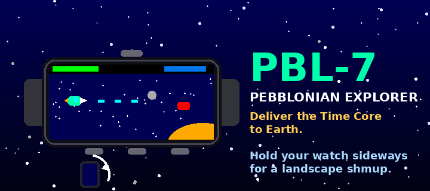

# PBL-7

A landscape shoot-'em-up for the Pebble Time 2 (emery).

**Hold the watch sideways** — a quarter turn clockwise, so the three buttons
line up along the bottom and the screen becomes a 228×200 landscape playfield.
You are **PBL-7, a Pebblonian explorer**, delivering the **Time Core** to Earth
to save it. Every planet sends its champion to stop you.



## Controls

Held sideways, bottom row left→right is **DOWN · SELECT · UP**, with **BACK** on
top.

| Button | In-game                          |
|--------|----------------------------------|
| UP     | hold to rise, release to fall    |
| DOWN   | fire (don't hold — it overheats) |
| SELECT | smart bomb (when charged)        |
| BACK   | pause                            |

On the title screen, **UP** opens Settings and **SELECT** starts.

## Gameplay

- A themed **boss** on each of Mercury → Neptune, each with its own gimmick
  (overheat haze, acid clouds, a drone-shield, a gravity well, splitting rings,
  a control-freezing chill, lightning storms).
- **Weapon heat:** sustained fire jams the gun — burst-fire instead, or turn
  the jam off (easy mode) in Settings.
- After each boss, pick one of **three upgrade cards** (kept for the run):
  Timeline Boost, Steel Armor, Round Shield, Rebble Core.
- **8 hidden collectible Pebbles**, one per planet. Find them all for the
  secret true ending.
- Secrets: beat Neptune **without a hit** to open a portal to **Pluto**
  (a boss-rush), then discover the hidden **Rebble** world, clear the **Moon
  base**, and face the three-phase **Earth** finale.

## Languages

Follows the watch's system language (`i18n_get_system_locale()`): English
(default/fallback), Nederlands, Français, Deutsch and Español. The translation
table is near the top of `src/c/main.c`.

## Building

```sh
pebble build
pebble install --emulator emery
```

The game logic runs in landscape coordinates (`u` right, `v` down); a small
`ls()`/`lp()` helper maps them to the native portrait framebuffer, so all
drawing stays plain primitives. Text uses a custom pre-rotated bitmap font
(`tools/gen_font.py` → `src/c/font_data.h`).

`tools/press.py` sends button presses to the running emulator over the
pypkjs websocket (`hold:up+down:1500` holds several buttons at once), handy for
headless testing:

```sh
~/.local/share/uv/tools/pebble-tool/bin/python tools/press.py select hold:up+down:1500 back
```

## Release

`tools/gen_icon.py` builds the launcher menu icon, `tools/gen_marketing.py` the
store icons + banner, and `tools/release.py` writes a size-optimised
`build/PBL7-release.pbw` for the appstore.

## License

MIT — see [LICENSE](LICENSE).
